# Hướng dẫn thực hiện từng bước: ESP32 + BME280, lấy mẫu cố định và thích nghi

Bạn dùng **Arduino IDE** hoặc **VS Code + PlatformIO**, đều được. Mỗi bước dưới đây có hình minh họa và cách làm cho cả hai công cụ.

```
esp32_bme280_project/
├── HUONG_DAN.md                       <- file này
├── images/                            <- hình minh họa
├── arduino/i2c_check/                 <- sketch kiểm tra kết nối (Bước 4)
├── arduino/adaptive_sampling/         <- sketch chính (Bước 5)
├── platformio/                        <- dự án PlatformIO (src/main.cpp, src/i2c_check.cpp)
├── tools/log_serial.py                <- ghi dữ liệu serial ra file CSV
└── tools/analyze.py                   <- tính R, MAE, RMSE
```

| Bước | Việc cần làm | Kết quả |
|---|---|---|
| 1 | Chuẩn bị linh kiện | Đủ đồ, đúng loại |
| 2 | Lắp mạch trên breadboard | Mạch lắp xong, chưa cấp nguồn |
| 3 | Cài công cụ và thư viện | Biên dịch được |
| 4 | Kiểm tra I2C | Thấy `0x76`, chip ID `0x60` |
| 5 | Nạp chương trình chính | Board in dòng dữ liệu qua serial |
| 6 | Chạy và ghi dữ liệu | Hai file CSV: fixed và adaptive |
| 7 | Đo năng lượng | Số mAh của hai chế độ |
| 8 | Phân tích | R, MAE, RMSE, hình so sánh |
| 9 | Đưa số liệu vào báo cáo | Chương 4 có số thật |

---

## Bước 1. Chuẩn bị

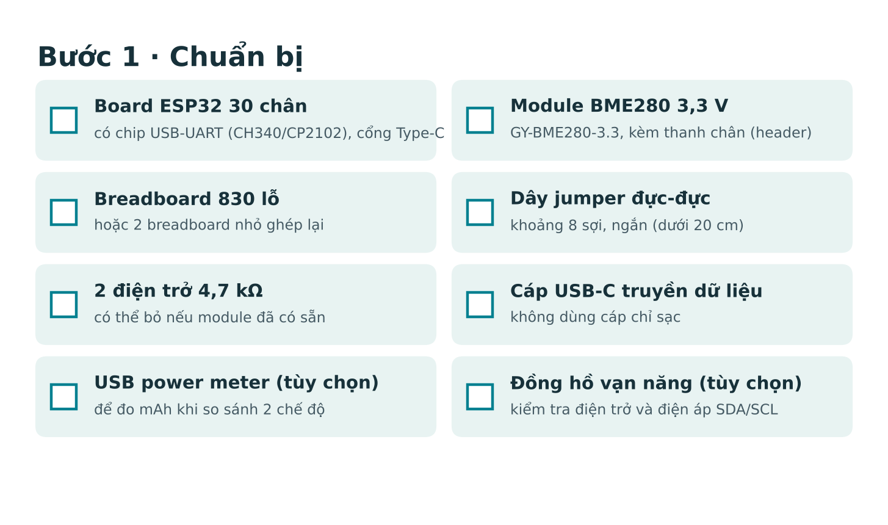

- Kiểm tra module BME280 là loại **3,3 V** và đã có thanh chân (header). Nếu thanh chân đi kèm rời thì hàn vào trước.
- Cáp USB-C phải là cáp **truyền dữ liệu**. Cáp chỉ sạc sẽ không hiện cổng COM.

## Bước 2. Lắp mạch trên breadboard

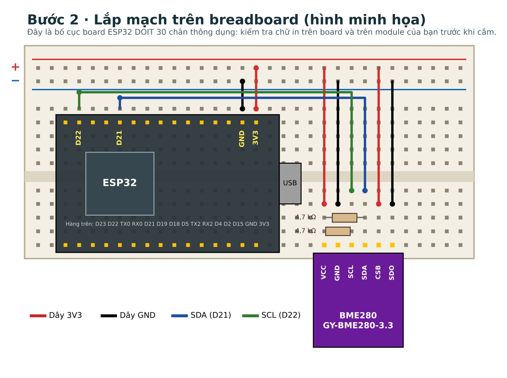

Sơ đồ nguyên lý tương ứng (dùng làm Hình 3.3 của báo cáo):

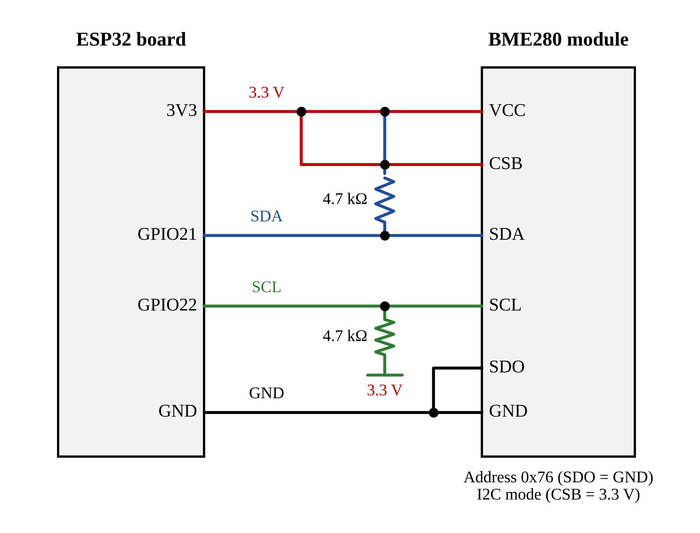

| Chân BME280 | Nối tới |
|---|---|
| VCC | 3V3 |
| GND | GND |
| SDA | GPIO21 |
| SCL | GPIO22 |
| CSB | 3V3 (chọn chế độ I2C) |
| SDO | GND (địa chỉ 0x76) |

Làm theo thứ tự:

1. Cắm ESP32 vào breadboard. Board 30 chân rất rộng nên chỉ còn **một hàng lỗ trống ở phía ngoài một bên**. Hãy quay board sao cho hàng chân chứa **D22, D21, GND, 3V3** nằm ở phía còn lỗ trống (ở board DOIT 30 chân phổ biến, cả bốn chân này đều cùng một bên). Nếu board của bạn khác bố cục, đối chiếu chữ in trên board, hoặc dùng thêm một breadboard nhỏ và dây cắm.
2. Nối 3V3 lên đường ray (+) và GND lên đường ray (−).
3. Cắm header BME280 vào hàng ngoài cùng của nửa dưới (hàng a), thân module thò ra ngoài mép breadboard. Dây và điện trở cắm vào các hàng b đến e của cùng cột. Thứ tự chân trên module thường là `VCC GND SCL SDA CSB SDO`, nhưng **hãy đọc chữ in trên module của bạn**.
4. Nối VCC và CSB vào đường ray (+); GND và SDO vào đường ray (−).
5. Nối SDA tới GPIO21, SCL tới GPIO22.
6. Điện trở 4,7 kΩ: một cái từ cột SDA sang cột VCC, một cái từ cột SCL sang cột VCC. **Khi chưa cấp nguồn**, đo điện trở giữa SDA và VCC trên module: nếu chỉ vài kΩ thì module đã có sẵn điện trở kéo lên, bạn có thể không cần gắn thêm.
7. Trước khi cắm USB, kiểm tra lần cuối: VCC nối vào **3V3**, không phải 5V hay VIN.

## Bước 3. Cài công cụ

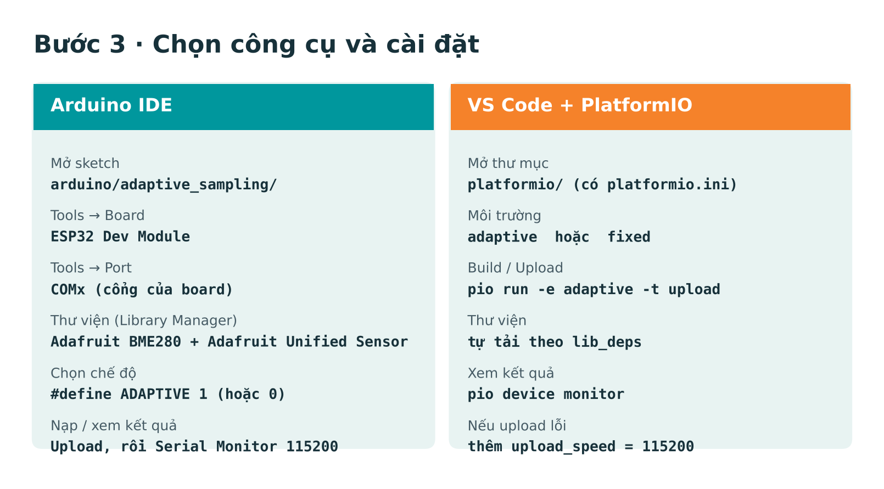

**Arduino IDE:** cần gói board `esp32 by Espressif Systems` (Boards Manager) và hai thư viện `Adafruit BME280 Library`, `Adafruit Unified Sensor` (Library Manager). Chọn `Tools → Board → ESP32 Dev Module` và đúng `Port`.

**PlatformIO:** dùng `File → Open Folder` và mở **đúng thư mục `platformio/`** (thư mục có `platformio.ini`), không mở thư mục ngoài cùng. Thư viện được tải tự động theo `lib_deps`. Có ba môi trường: `i2c_check` (Bước 4), `adaptive` và `fixed` (Bước 5). Nếu VS Code gạch đỏ ở `#include <Wire.h>`, chạy `PlatformIO: Rebuild IntelliSense Index` (Ctrl+Shift+P) hoặc build một lần (`pio run`), lỗi gạch đỏ sẽ hết.

## Bước 4. Kiểm tra kết nối I2C

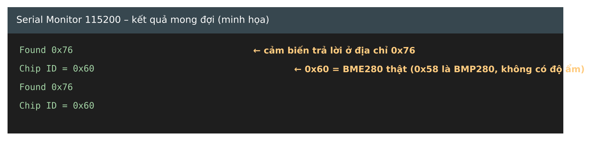

- **Arduino IDE:** mở `arduino/i2c_check/i2c_check.ino`, Upload, mở Serial Monitor ở 115200.
- **PlatformIO:** chạy `pio run -e i2c_check -t upload` rồi `pio device monitor` (file `src/i2c_check.cpp` đã có sẵn). Đừng mở file `.ino` trong thư mục `arduino/` bằng VS Code để biên dịch: file `.ino` nằm ngoài dự án PlatformIO nên không tìm thấy `Wire.h`.

Kết quả đúng: `Found 0x76` và `Chip ID = 0x60`. Nếu ID là `0x58` thì đó là BMP280 (không có độ ẩm): đổi module trước khi làm tiếp.

## Bước 5. Nạp chương trình chính

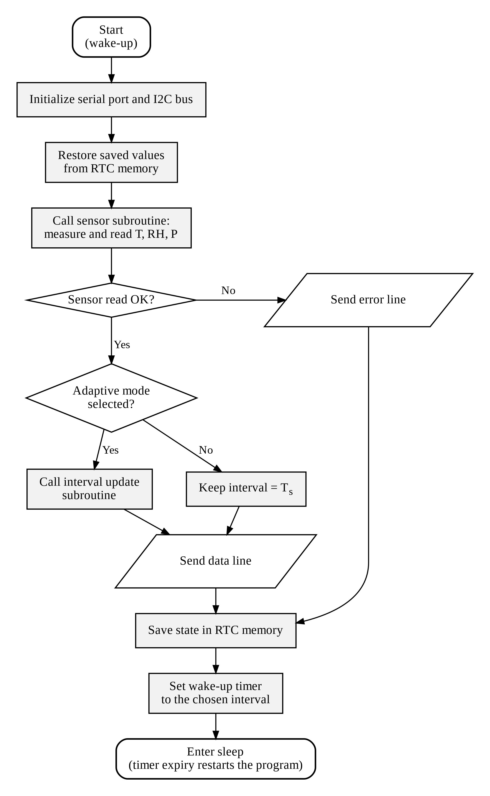

Chương trình làm đúng lưu đồ này: thức dậy, đo ở forced mode, cập nhật chu kỳ, in một dòng, lưu trạng thái trong bộ nhớ RTC, rồi deep sleep.

Các tham số nằm ở đầu file, đặt tên giống Bảng 3.6:

| Tham số | Mặc định | Ý nghĩa |
|---|---|---|
| `TS_S` | 10 | Chu kỳ chế độ cố định (s) |
| `TMIN_S`, `TMAX_S` | 10, 120 | Chu kỳ nhỏ nhất, lớn nhất của chế độ thích nghi (s) |
| `DT_S` | 10 | Bước tăng chu kỳ (s) |
| `TH_T`, `TH_H` | 0,3; 2,0 | Ngưỡng nhiệt độ (°C), độ ẩm (%RH) |

- **Arduino IDE:** mở `arduino/adaptive_sampling/adaptive_sampling.ino`. Dòng `#define ADAPTIVE 1` chọn chế độ (1 = thích nghi, 0 = cố định). Upload, mở Serial Monitor 115200.
- **PlatformIO:** `pio run -e adaptive -t upload` hoặc `pio run -e fixed -t upload`, rồi `pio device monitor`. Mỗi môi trường chỉ biên dịch `main.cpp`, nên không bị trùng `setup()` với `i2c_check.cpp`.

Mỗi dòng dữ liệu có dạng `time_s,temp_c,hum_rh,press_hpa,mode,interval_s`. Cột `interval_s` là thời gian chờ đến lần đo kế tiếp.

## Bước 6. Chạy thử và ghi dữ liệu

Chế độ cố định (chu kỳ luôn 10 s):

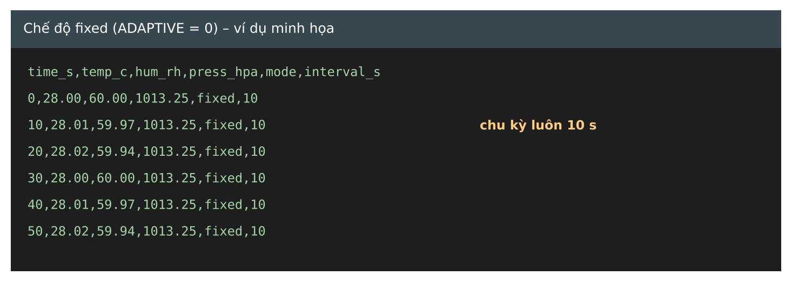

Chế độ thích nghi (chu kỳ tăng dần khi môi trường ổn định):

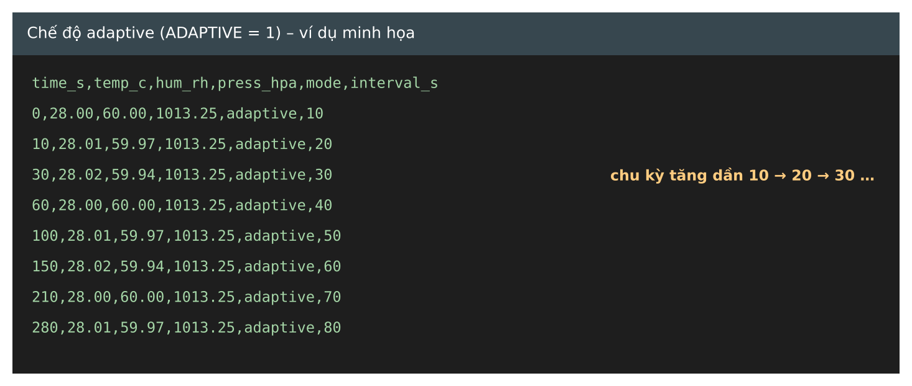

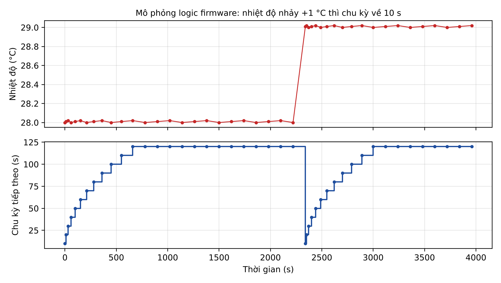

*Các hình trên là kết quả mô phỏng logic firmware trên máy tính, không phải dữ liệu đo thật.*

Kịch bản thử gợi ý (giống nhau cho cả hai chế độ): để yên 10 phút, rồi hà hơi hoặc áp ngón tay lên cảm biến khoảng 1 phút, rồi để nguội 10 phút. Ở chế độ thích nghi, bạn sẽ thấy chu kỳ tăng dần, quay về `10` khi nhiệt độ hoặc độ ẩm đổi nhiều, rồi tăng lại.

Ghi ra file:

- **PlatformIO:** thêm vào `platformio.ini` dòng `monitor_filters = log2file`, hoặc dùng cách bên dưới.
- **Cả hai công cụ:** `pip install pyserial` rồi chạy `python tools/log_serial.py COM5 fixed.csv` (đổi cổng cho đúng). **Chạy lệnh này trước khi reset/cấp nguồn board**, vì mở cổng serial có thể làm ESP32 khởi động lại. Đóng Serial Monitor trước khi chạy vì chỉ một chương trình giữ được cổng.

Lưu ý:
- Bấm nút EN (reset) hoặc rút nguồn sẽ bắt đầu log mới (in lại dòng tiêu đề, `time_s` về 0).
- `time_s` được cộng từ các chu kỳ nên chu kỳ thực hơi dài hơn khoảng 0,3 đến 0,5 s mỗi lần (thời gian khởi động), cộng sai số bộ hẹn giờ.
- Dòng có chữ `ERROR` (ví dụ `bme280_not_found`) báo lỗi cảm biến. Chương trình vẫn đi ngủ và thử lại ở chu kỳ sau.

## Bước 7. Đo năng lượng

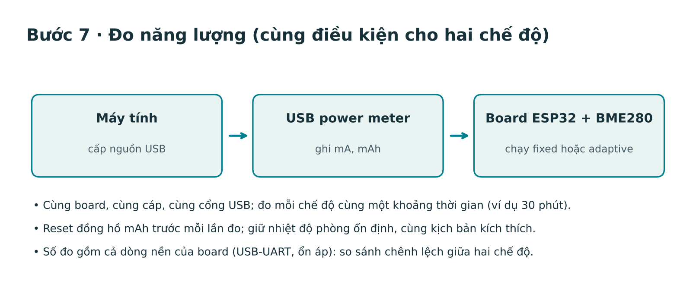

Mỗi chế độ làm một lần, **cùng điều kiện**: cùng board, cáp, cổng USB, cùng thời gian (ví dụ 30 phút), cùng kịch bản kích thích. Ghi lại:

| Chế độ | Thời gian | mAh (trên power meter) | Số lần đọc | Ghi chú |
|---|---|---|---|---|
| fixed | | | | |
| adaptive | | | | |

Tỉ lệ tiết kiệm `S = (E_cố định − E_thích nghi) / E_cố định × 100%`. Số đo gồm cả dòng nền của board (chip USB-UART, bộ ổn áp), nên hãy nói rõ khi báo cáo rằng bạn so sánh **chênh lệch** giữa hai chế độ.

## Bước 8. Phân tích kết quả

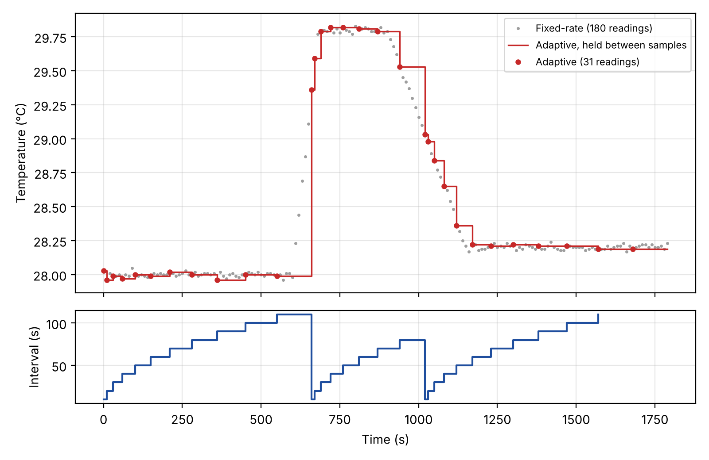

*Hình trên là ví dụ trên dữ liệu giả lập, để bạn biết kết quả sẽ trông thế nào.*

```
python tools/analyze.py fixed.csv adaptive.csv --plot so_sanh.png
```

Nếu hai lần chạy không cùng điều kiện, có thể chỉ chạy chế độ cố định rồi cho máy tính **phát lại** quy tắc thích nghi trên chính log đó (cùng một môi trường):

```
python tools/analyze.py --replay fixed.csv --plot so_sanh.png
```

Chương trình in số lần đọc, tỉ lệ giảm `R`, MAE, RMSE, sai số lớn nhất và phần trăm điểm nằm trong dung sai của cảm biến (±0,5 °C, ±3 %RH). Cách phát lại chỉ cho `R` và sai số dữ liệu, **không thay cho số mAh đo thật** ở Bước 7.

Lưu ý với yêu cầu R7 trong Bảng 3.1: ở ví dụ giả lập, sai số trung bình rất nhỏ nhưng sai số **lớn nhất** vượt 0,5 °C ngay sau lúc nhiệt độ tăng nhanh, vì cảm biến đang ngủ dài. Nếu số đo thật cũng vậy, hãy quyết định cách phát biểu R7 (ví dụ theo MAE hoặc theo phần trăm điểm trong dung sai) hoặc giảm `TMAX_S`, và nói rõ trong báo cáo.

## Bước 9. Đưa số liệu vào báo cáo

1. Thay các giá trị trong ngoặc vuông ở Bảng 3.1 và Bảng 3.6 bằng giá trị bạn đã dùng thật.
2. Chương 4: mô tả mạch đã lắp (ảnh thật của bạn), kịch bản thử, bảng số lần đọc và mAh của hai chế độ, hình so sánh, MAE/RMSE.
3. Điền lại mục tiêu `[X %]` ở slide và file vấn đáp bằng số đo thật.

## Lỗi thường gặp

| Hiện tượng | Nguyên nhân thường gặp |
|---|---|
| VS Code báo không tìm thấy `Wire.h` | Mở sai thư mục hoặc mở file `.ino` rời; mở thư mục `platformio/` rồi Rebuild IntelliSense Index |
| Không thấy cổng COM | Cáp chỉ sạc, thiếu driver CH340/CP2102 |
| Upload báo lỗi kết nối | Giữ nút BOOT khi thấy `Connecting....`; giảm tốc độ upload (115200) |
| Không thấy `0x76` | SDA và SCL đảo, CSB chưa nối 3V3, dây breadboard lỏng |
| Thấy `0x77` | SDO đang nối 3V3, nối lại về GND |
| Chip ID là `0x58` | Module là BMP280, không có độ ẩm |
| In `ERROR,bme280_not_found` | Sai địa chỉ (`BME_ADDR`) hoặc lỏng dây |
| Chữ lạ trong Serial Monitor | Chưa đặt 115200 |
| Chu kỳ thích nghi không tăng | Ngưỡng nhỏ hơn nhiễu hoặc môi trường đang đổi; tăng `TH_T`, `TH_H` |

## Điều cần biết

- Logic quy tắc thích nghi và định dạng dòng dữ liệu đã được kiểm tra trên máy tính bằng giả lập, **nhưng chương trình chưa được chạy trên phần cứng thật**. Hãy thử từng bước và báo lại nếu gặp lỗi.
- Hình breadboard là minh họa; vị trí chân thật phụ thuộc board của bạn.
- Các hình kết quả (Bước 6 và 8) là dữ liệu mô phỏng, không phải số đo.
