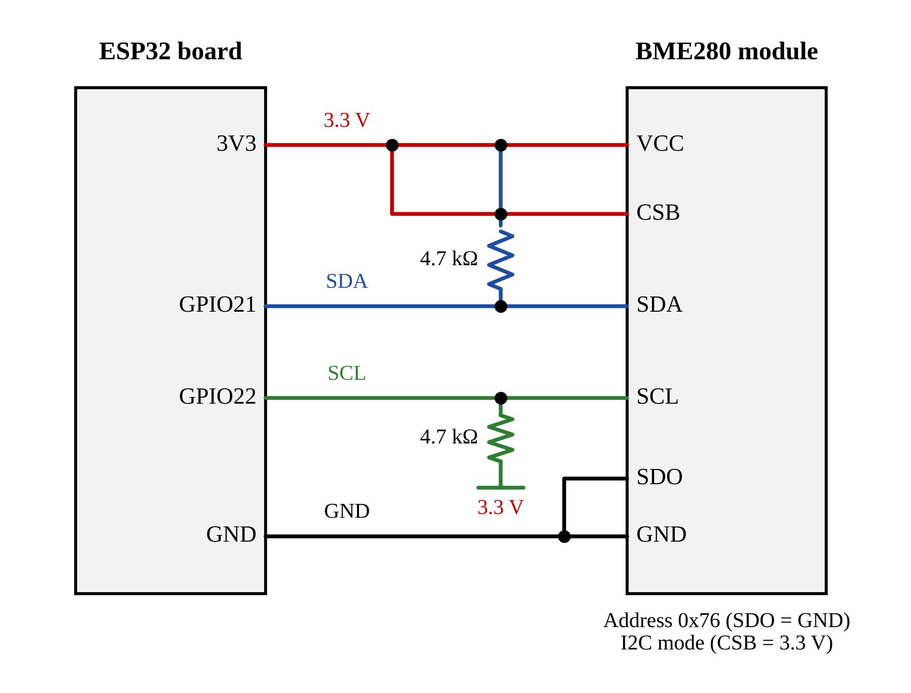

# Wiring: ESP32 and BME280 on a breadboard

Module: GY-BME280-3.3 (3.3 V version). Bus: I2C. Power: USB cable from the computer.

| BME280 pin | Connect to |
|---|---|
| VCC | ESP32 3V3 |
| GND | ESP32 GND |
| SDA | GPIO21 |
| SCL | GPIO22 |
| CSB | 3V3 (selects I2C mode) |
| SDO | GND (I2C address 0x76) |

Add one 4.7 kOhm resistor from SDA to 3V3 and one from SCL to 3V3.
Many modules already have pull-up resistors: with the power off, measure the resistance between SDA and VCC on the module. If it is a few kOhm, the external resistors are not needed.

## Before powering

1. VCC goes to 3V3, never to 5V or VIN.
2. Keep SDA and SCL wires short (under about 20 cm).
3. SDO must not float: tie it to GND (0x76) or 3V3 (0x77).

## Check

Upload `firmware/i2c_check/i2c_check.ino` and open the Serial Monitor at 115200 baud.

- `Found 0x76`: the sensor answers on the bus.
- `Chip ID = 0x60`: a real BME280. `0x58` means a BMP280, which has no humidity sensor.
